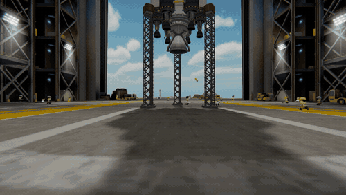
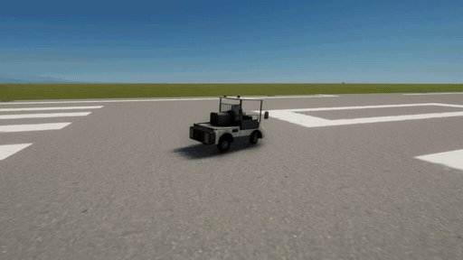

# On Foot

Walk the floor of the assembly building and the hangar in first person, at a kerbal's height: among the ground crew,
under the rocket on its clamps, out through the great door. And a car for the ground crew to drive about the space
centre: an airport baggage tug.

For Kerbal Space Program 1.12.x. **Needs [Keystone](https://github.com/IshiakiZ/ksp-keystone) 0.9 or later**, a separate download
([on SpaceDock](https://spacedock.info/mod/4665/Keystone)): this mod does not load without it.

## Install

Copy the `OnFoot` folder from the download into your KSP's `GameData`, beside `Keystone`.

## Use

* **Walk:** in the assembly building or the hangar, press **Alt-W** (Option-W on a Mac). Walk with **W A S D**, look
  with the mouse, run with **Shift**, jump with **Space**. **Alt-W** or **Esc** stops, and the game's camera comes
  back to where it was.
* **From the space centre:** point at the assembly building or the hangar and press **Alt-W** to go in on foot.
* **The crew car:** from the space centre, press **Drive the crew car** on the mod's page in the Keystone window (the
  keystone button on the game's toolbar, or Alt-K; Option-K on a Mac). It is put on the runway and driven with the
  rover keys.

The same page has the walking and running speeds, the eye height, the mouse, the field of view and how loud
your footsteps are (since 0.3.0: by what is underfoot, a hard floor, a grating or soft ground). Since 0.3.0 the
ground crew make way for you, stepping aside to pass about a metre off, and the ladders a kerbal can climb are
climbed: walk into one, back goes down, **Space** lets go. Look down and you see yourself: one of the ground crew's own
bodies, its arms swinging and its knees stepping in time with you. With Keystone 0.11.0, seven finer details in its
Advanced view: how high you jump, the highest step and the steepest slope walked up, how long the view takes to come down
to your eyes and to rise back, and how much room the ground crew give you.
[All of them](https://github.com/IshiakiZ/ksp-on-foot/wiki/The-long-description#install-and-use).

## Good to know

* Only the assembly building and the hangar have an inside to walk in.
* Nothing of the building, the craft or the game's controls is changed by a walk.

## Works on

Mac: tried. Windows 11 (Direct3D 11): 0.2.1 tried; what 0.3.0 adds, not yet. Linux: never run.

**More:** [the long description](https://github.com/IshiakiZ/ksp-on-foot/wiki/The-long-description) (everything in full, and what was
tried on each system) and the rest of the [wiki](https://github.com/IshiakiZ/ksp-on-foot/wiki).

## Licence

[CC BY 4.0](LICENSE): use it, change it and pass it on as you like, as long as you credit Ishiaki and link back here.
